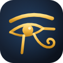

<p align="center">
  
</p>

<h1 align="center">Horus Eye</h1>

<p align="center">
  Watch your home CCTV cameras on an LG webOS TV — no cloud, no vendor app, just your LAN.
</p>

---

## Why

Most home NVRs (network video recorders) stream **HEVC video with G.711 audio over RTSP**. TVs and browsers can't play that directly, LG TVs have no good RTSP viewer, and the vendor apps usually route your video through somebody else's cloud.

Horus Eye fixes that with two small pieces that stay entirely on your home network:

- a **bridge** on any always-on Windows PC that converts the NVR's streams into something a TV can play, and
- a **TV app** that finds your cameras automatically and shows them in a grid you drive with the remote.

No accounts, no subscriptions, no port forwarding, and your footage never leaves the house.

## How it works

```
 ┌─────────┐   RTSP (HEVC + G.711)   ┌──────────────────────────┐   HTTP / WebSocket (H.264 + AAC)   ┌──────────────┐
 │   NVR   │ ──────────────────────▶ │  Bridge PC               │ ─────────────────────────────────▶ │  LG webOS TV │
 │ cameras │                         │  go2rtc + ffmpeg :1984   │                                    │  Horus Eye   │
 └─────────┘                         └──────────────────────────┘                                    └──────────────┘
```

1. **Bridge** — [go2rtc](https://github.com/AlexxIT/go2rtc) pulls each camera from the NVR and runs it through ffmpeg (HEVC → H.264, G.711 → AAC, 1-second keyframes so viewers start fast). It serves the result on port `1984` as WebRTC, MSE-over-WebSocket and HLS.
2. **TV app** — a single-file webOS web app (`webos-camera-app/index.html`, plain JavaScript, no framework) that:
   - discovers cameras from `GET /api/streams` and keeps the grid in sync every 15 s,
   - plays the focused tile live and shows refreshing snapshots for the others (TVs can only decode one video at a time),
   - opens a camera fullscreen in its high-resolution stream, with mute / pause / close controls,
   - falls back WebRTC → MSE → HLS automatically, and reconnects stalled streams on its own,
   - remembers the bridge address and which cameras to show.

## Features

- 📺 Auto-sizing grid (1–4 columns) driven entirely by the TV remote
- ⚡ ~1 s start time for grid cameras (pre-connected streams)
- 🔍 Fullscreen with the camera's main (high-res) stream and audio
- ⚙️ On-TV settings: bridge address and per-camera show/hide
- 🔒 Local only — nothing leaves your network
- 🧩 Works with any camera/NVR that speaks RTSP

## What you need

| Piece | Notes |
| --- | --- |
| An NVR or IP cameras with RTSP | Tested with an NVR serving HEVC; anything go2rtc + ffmpeg can read will work |
| An always-on PC on the same LAN | Windows is what this repo is set up for; go2rtc and ffmpeg also run on Linux/macOS/Raspberry Pi |
| [go2rtc](https://github.com/AlexxIT/go2rtc/releases) | Single binary |
| [ffmpeg](https://ffmpeg.org/download.html) | e.g. `winget install Gyan.FFmpeg` |
| An LG webOS TV | Developed on webOS 5 (2020, Chromium 68); newer webOS versions should work |
| [LG Developer Mode](https://webostv.developer.lge.com/develop/getting-started/developer-mode-app) | Free; needed to install unsigned apps |

## Setup

### 1. The bridge

1. Download `go2rtc.exe` into the `go2rtc/` folder.
2. Copy the example config and fill in your NVR details:
   ```bash
   cp go2rtc/go2rtc.example.yaml go2rtc/go2rtc.yaml
   ```
   - Replace `USER`, `PASSWORD`, `NVR_IP` and the channel paths with your NVR's RTSP URLs.
   - Give each camera a `<Name>` (substream, for the grid) and `<Name>_fs` (main stream, for fullscreen).
   - Set `ffmpeg.bin` to your ffmpeg path.
   - `go2rtc.yaml` is git-ignored on purpose — **it holds your camera password; never commit it.**
3. Run it:
   ```bash
   cd go2rtc && ./go2rtc.exe
   ```
4. Check it at `http://localhost:1984` — you should see your streams and be able to play them in a browser.
5. *(Optional)* Make it start at boot with Task Scheduler (trigger: at startup, run `go2rtc.exe` from the `go2rtc` folder).

> **Tip:** give the bridge PC a DHCP reservation on your router so its IP never changes — the TV app stores that address.

> **NVR session limits:** many NVRs only allow a handful of simultaneous RTSP sessions and may refuse connections (or even reboot) beyond that. Keep only the grid streams in `preload:` and leave the `_fs` streams on demand.

### 2. The TV app

**Option A — download a release (easiest)**

Grab the latest `.ipk` from the [Releases](../../releases) page.

**Option B — Homebrew Channel (one-click installs and updates)**

If you have [Homebrew Channel](https://github.com/webosbrew/webos-homebrew-channel) on your TV, add this repository to it once:

1. Open Homebrew Channel → **Settings** → **Add repository**.
2. Enter:
   ```
   https://github.com/mahmoudelwekel/horus-eye/releases/latest/download/apps.json
   ```
3. Horus Eye now appears in the app list. Install it from there; new releases show up as updates you can install with one click.

Homebrew Channel works without root, through Developer Mode, so the Developer Mode expiry below still applies unless your TV is rooted.

**Option C — build it yourself**

```bash
npm install -g @webos-tools/cli
ares-package webos-camera-app -o out
```

**Install on the TV**

1. Install the **Developer Mode** app from the LG Content Store, sign in with a free LG developer account, and turn on Dev Mode (the TV restarts).
2. Register the TV with the CLI (use the passphrase shown in the Developer Mode app):
   ```bash
   ares-setup-device            # add the TV, e.g. name "tv", its IP, port 9922
   ares-novacom --device tv --getkey
   ```
3. Install and launch:
   ```bash
   ares-install -d tv com.home.cameradashboard_1.0.0_all.ipk
   ares-launch -d tv com.home.cameradashboard
   ```
4. On first launch, open **Settings** (the gear, top right), enter the bridge PC's IP, and pick which cameras to show.

> Developer Mode sessions expire after ~50 hours unless you press **Extend** in the Developer Mode app; when it expires the TV removes the app.

## Using it

| Remote button | Grid | Fullscreen |
| --- | --- | --- |
| Arrows | Move between cameras / to the gear | Left/Right: choose mute, pause, close |
| OK | Open camera fullscreen | Activate the selected control |
| Back | — | Exit fullscreen |

On a desktop browser you can open `webos-camera-app/index.html` directly and use the arrow keys, Enter and Esc.

## Troubleshooting

- **"Can't reach the bridge"** — check the PC's IP (`ipconfig`), that go2rtc is running, and that Windows Firewall allows port 1984.
- **A camera is slow or choppy** — check it in go2rtc's web UI first; if the NVR sends it at a low frame rate, the app can't do better.
- **Cameras drop after opening fullscreen** — you're hitting the NVR's session limit; reduce `preload:` entries.
- **Debugging on the TV** — with the app open, Chrome DevTools is available at `http://<tv-ip>:9998`.

## Releases

Every merge to `master` builds the IPK with GitHub Actions and publishes it as a release tagged `v<version>` from `webos-camera-app/appinfo.json`. Bump `version` there to cut a new release; merging without a bump refreshes the existing release's file.

## Contributing

`master` is protected: changes go through a pull request and need the maintainer's approval before merging.

1. Fork the repo and create a branch.
2. Make your change and test it on a real TV if you can — webOS's old Chromium hides many issues a desktop browser won't show (see `CLAUDE.md` for the known quirks).
3. Open a pull request against `master`.

## Credits

- [go2rtc](https://github.com/AlexxIT/go2rtc) by AlexxIT — the streaming bridge
- [hls.js](https://github.com/video-dev/hls.js) — HLS fallback (vendored, Apache-2.0)
- [FFmpeg](https://ffmpeg.org/) — transcoding
